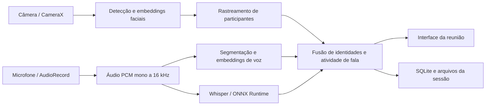

# AV Tracker · Multimodal IA

Aplicativo Android que reúne **identificação de rostos, identificação de falantes e transcrição de áudio** em uma interface de acompanhamento de reuniões.

O projeto implementa em **Kotlin e ONNX Runtime** os componentes do [av-tracker](https://github.com/manuelazotavio/av-tracker), com processamento multimodal no próprio dispositivo. A aplicação combina a imagem da câmera, as características da voz e a atividade dos participantes para organizar as informações de cada sessão.

## Funcionalidades

- **Detecção e acompanhamento de rostos:** caixas sobre a imagem da câmera, identificadores por participante e reconhecimento com embeddings faciais.
- **Identificação por voz:** comparação de embeddings de falantes, acompanhamento das identidades e associação com os rostos observados.
- **Transcrição local:** seleção entre Whisper Base e Whisper Small, com português em dispositivos configurados nesse idioma.
- **Atividade de fala:** combinação de evidências de áudio e imagem para associar a fala aos participantes.
- **Perfis persistentes:** armazenamento de identidades e embeddings para reutilização entre sessões.
- **Organização da reunião:** quantidade opcional de participantes e identificação das vozes ao encerrar a sessão.
- **Exportação de resultados:** transcrição, gravação WAV, métricas e relatórios da sessão.
- **Análise opcional de nomes:** reconhecimento de entidades com spaCy exportado para Kotlin e análise por IA configurável na interface.
- **Modo de colaboração com VocalID:** opção para usar o AV Tracker nas faces e abrir o VocalID para o fluxo de áudio.

## Arquitetura



O modo multimodal executa a inferência de visão e áudio localmente. Os scripts Python preparam os modelos e os dados utilizados pelo aplicativo; a execução Android utiliza Kotlin e bibliotecas nativas.

### Componentes principais

| Componente | Tecnologia | Papel no aplicativo |
|---|---|---|
| Captura de imagem | CameraX | Prévia, análise dos quadros e transformação das coordenadas das caixas |
| Detecção facial | YOLOv8 Face | Localização dos rostos |
| Reconhecimento facial | EdgeFace XXS | Embeddings e comparação de identidades |
| Reconhecimento de voz | ECAPA-TDNN / SpeechBrain | Embeddings de falantes e verificação de identidade |
| Segmentação de falantes | pyannote | Localização dos turnos de fala |
| Diarização completa opcional | pyannote + WeSpeaker | Segmentação, embeddings e agrupamento de falantes |
| Detecção de fala | Silero VAD | Identificação de presença de fala no áudio |
| Transcrição | Whisper Base / Small | Conversão de áudio em texto |
| Entidades e nomes | spaCy exportado | Tokenização, análise linguística e extração de nomes |
| Persistência | SQLite, JSON e WAV | Perfis, sessões, gravações e métricas |

## Tecnologias e ambiente

| Item | Configuração do projeto |
|---|---|
| Linguagem Android | Kotlin |
| Android mínimo | 7.0 — API 24 |
| Compile SDK / Target SDK | API 35 |
| Arquiteturas do APK | `arm64-v8a` e `x86_64` |
| Android Gradle Plugin | 9.4.0 |
| Gradle Wrapper | 9.6.0 |
| Plugin de serialização Kotlin | 2.4.10 |
| ONNX Runtime | 1.19.2 |
| CameraX | 1.4.1 |
| JDK utilizado no desenvolvimento | 21 |
| Dispositivo utilizado no desenvolvimento | Jabra PanaCast 40 VBS, Android 13 |

O projeto também pode ser aberto no Android Studio. O Gradle Wrapper acompanha o repositório e permite usar a versão de Gradle configurada pelo projeto.

## Preparação do projeto

### 1. Clonar e configurar o Android SDK

```powershell
git clone https://github.com/manuelazotavio/multimodal_IA.git
cd multimodal_IA
```

Configure `JAVA_HOME` para o JDK e `ANDROID_HOME` para a instalação do Android SDK. Instale a plataforma Android SDK 35 e o Platform Tools pelo SDK Manager.

No Android Studio, a localização do SDK pode ser configurada ao abrir o projeto. Pela linha de comando, crie um `local.properties` na raiz com o caminho da sua instalação:

```properties
sdk.dir=C:/Android/Sdk
```

### 2. Preparar os assets de IA

Os modelos e os perfis são gerados localmente e ficam em `src/main/assets/`. Esse fluxo permite preparar o conjunto de modelos e identidades de cada instalação.

| Pasta ou arquivo | Conteúdo |
|---|---|
| `models/yolov8n_face.onnx` | Detector de rostos |
| `models/edgeface_xxs.onnx` | Embeddings faciais |
| `models/ecapa_voxceleb.onnx` | Embeddings de voz |
| `models/pyannote_segmentation.onnx` | Segmentação de falantes |
| `models/silero_vad_v6.onnx` | Detecção de fala |
| `models/wespeaker_resnet34.onnx` | Embeddings para o modo de diarização completa |
| `models/light_asd.onnx` | Modelo do caminho opcional de atividade de fala |
| `whisper/` | Whisper Base: `encoder.onnx`, `decoder.onnx`, `tokens.txt` e `meta.json` |
| `whisper-small/` | Whisper Small no mesmo contrato de exportação do aplicativo |
| `ner/pt/` e `ner/en/` | Dados de tokenização, NER e parser do spaCy |
| `face_embeddings/` | Perfis faciais iniciais exportados |
| `voice_embeddings/` | Perfis de voz iniciais exportados |

Modelos, perfis, ambientes virtuais e configurações locais são mantidos fora do Git pelas regras do `.gitignore`.

#### Ambiente Python para exportação

Use um ambiente virtual dedicado. Os comandos abaixo usam PowerShell; os mesmos scripts podem ser executados em um ambiente Python configurado em outro sistema.

```powershell
python -m venv .venv
.\.venv\Scripts\Activate.ps1
python -m pip install --upgrade pip
python -m pip install numpy torch torchaudio onnx onnxslim onnxruntime timm ultralytics speechbrain pyannote.audio faster-whisper transformers tokenizers huggingface_hub spacy
python -m spacy download pt_core_news_sm
python -m spacy download en_core_web_sm
```

Para preparar os modelos disponibilizados pelo Hugging Face, autentique o ambiente com uma conta que tenha acesso aos modelos utilizados e os respectivos termos aceitos:

```powershell
hf auth login
```

#### Exportar visão, voz e segmentação

Disponibilize o projeto `av-tracker` com os pesos e os perfis de origem esperados pelo exportador. O script lê os pesos faciais em `od_model/` e os perfis em `data/face_embeddings/` e `data/embeddings/`.

```powershell
python scripts/export_models.py --av-tracker ../av-tracker
```

#### Exportar Whisper

Baixe os modelos multilíngues e gere os assets no formato usado pelo motor Kotlin:

```powershell
python -c "from huggingface_hub import snapshot_download; snapshot_download('openai/whisper-base', local_dir='models/whisper-base')"
python scripts/export_whisper.py --model-dir models/whisper-base --out src/main/assets/whisper

python -c "from huggingface_hub import snapshot_download; snapshot_download('openai/whisper-small', local_dir='models/whisper-small')"
python scripts/export_whisper.py --model-dir models/whisper-small --out src/main/assets/whisper-small
```

O exportador produz os grafos ONNX, o vocabulário e os metadados usados pelo aplicativo. A interface oferece os modelos disponíveis nos assets e salva a seleção para as próximas sessões.

#### Exportar os componentes linguísticos

```powershell
python scripts/export_ner.py
python scripts/export_parser.py
```

Os scripts preparam português e inglês por padrão. O parâmetro `--models` permite selecionar os modelos spaCy a exportar.

## Compilar e instalar

Com os assets preparados:

```powershell
.\gradlew.bat assembleDebug
```

O APK é gerado em:

```text
build/outputs/apk/debug/multimodal_IA-debug.apk
```

Conecte o dispositivo, habilite a depuração USB e autorize o computador. Depois utilize o ADB do Android SDK:

```powershell
adb devices
adb -s <serial> install -r -g build/outputs/apk/debug/multimodal_IA-debug.apk
adb -s <serial> shell am start -n com.avtracker.mobile/.ui.MainActivity
```

Em Linux ou macOS, o comando equivalente de compilação é `bash ./gradlew assembleDebug`.

## Usar na Jabra PanaCast 40 VBS

1. Abra o **AV Tracker** e conceda acesso à câmera e ao microfone.
2. Informe a quantidade de participantes ou deixe o campo vazio para acompanhamento sem quantidade predefinida.
3. Para o fluxo multimodal do próprio AV Tracker, mantenha a opção de áudio do VocalID desmarcada.
4. Escolha o modelo de transcrição disponível: **Base** ou **Small**.
5. Selecione as opções de diarização e análise de nomes desejadas e confirme em **OK**.
6. Acompanhe os rostos na prévia da câmera e os segmentos de transcrição na área de texto.
7. Ao terminar, toque em **Encerrar sessão**. O fluxo permite nomear as vozes identificadas e salvar os resultados.

A área de status informa o modelo em uso, por exemplo, **“Ouvindo · Whisper small”**. A escolha do modelo e das opções de áudio fica salva no dispositivo. Resultados marcados como **“Texto incerto”** mantêm essa identificação na exportação da transcrição.

### Espelhar a tela no computador

Com o [scrcpy](https://github.com/Genymobile/scrcpy) instalado:

```powershell
scrcpy --serial=<serial> --display-id=0 --no-audio --max-size=1280 --window-title=AV-Tracker
```

Esse comando espelha a tela e permite interagir com o aplicativo pelo computador. A opção `--no-audio` desativa a reprodução do som pelo espelhamento; a captura de microfone do AV Tracker continua no dispositivo Android.

## Modos de operação

### Multimodal local

O AV Tracker utiliza câmera e microfone do dispositivo, identifica participantes, transcreve os segmentos e organiza os resultados da sessão. O motor combina verificação de voz, atividade de fala e reconhecimento facial para acompanhar as identidades.

### Faces com VocalID

A opção **“Usar VocalID para vozes e transcrição”** inicia o AV Tracker no modo facial e disponibiliza o botão **Abrir VocalID**. Nesse fluxo, o AV Tracker acompanha os rostos e o aplicativo VocalID apresenta seu próprio áudio, falantes e transcrições. Os resultados são acompanhados nas interfaces de cada aplicativo.

### Análise opcional por IA

A análise de nomes por IA pode ser habilitada na configuração da sessão. Quando ativada com um token do Hugging Face, envia trechos da transcrição ao serviço de inferência para apoiar a identificação dos falantes. O processamento de visão, áudio e Whisper permanece local.

## Arquivos e persistência

Ao salvar uma reunião, o aplicativo organiza os resultados em sua pasta `realtime_sessions`:

```text
transcript_<data_hora>.txt
audio_<data_hora>.wav
metrics_<data_hora>.json
fn_report_<data_hora>.txt
fp_report_<data_hora>.txt
```

Os arquivos correspondentes são produzidos conforme os dados da sessão. As transcrições incluem horário, identificação do falante e texto. As métricas reúnem informações do processamento e das decisões de identificação.

No armazenamento externo específico do aplicativo, a pasta é:

```text
/sdcard/Android/data/com.avtracker.mobile/files/realtime_sessions/
```

Para copiar os resultados para o computador:

```powershell
adb -s <serial> pull /sdcard/Android/data/com.avtracker.mobile/files/realtime_sessions/ ./build/sessions/
```

O banco local `av_tracker.db` mantém os registros de sessões e perfis. Os embeddings faciais e de voz também são gerenciados no armazenamento privado do aplicativo.

## Testes e avaliação

O projeto inclui testes JVM para rastreamento, fusão de identidades, filtros de transcrição, persistência, processamento de áudio, componentes linguísticos e inferência ONNX. Os testes que executam modelos utilizam os assets preparados no ambiente de desenvolvimento.

```powershell
# Suíte de testes JVM
.\gradlew.bat testDebugUnitTest

# Conjunto focado em transcrição e fusão
.\gradlew.bat testDebugUnitTest --tests com.avtracker.mobile.whisper.WhisperTest --tests com.avtracker.mobile.whisper.WhisperSmallTest --tests com.avtracker.mobile.fusion.FusionEngineTest --tests com.avtracker.mobile.fusion.FusionPartsTest
```

O relatório HTML fica em `build/reports/tests/testDebugUnitTest/index.html`.

### Comparar transcrições com frases conhecidas

O script `benchmark_azure_speech.py` gera um pequeno corpus em português pelo Azure Speech. A credencial é lida de um arquivo local e os áudios são salvos em `build/asr-benchmark/`.

```powershell
python -m pip install azure-cognitiveservices-speech
python scripts/benchmark_azure_speech.py --key-file <arquivo-local-da-chave> --endpoint <endpoint-azure>
.\gradlew.bat testDebugUnitTest --tests com.avtracker.mobile.whisper.AzureSpeechBenchmarkTest
python scripts/report_speech_benchmark.py
```

O relatório `build/asr-benchmark/relatorio.md` compara os textos de referência com as transcrições e apresenta os tempos de processamento medidos no computador. Os testes de diagnóstico adicionais podem ser habilitados por variáveis de ambiente, conforme os comentários das respectivas classes em `src/test/`.

## Estrutura do repositório

```text
src/main/
  AndroidManifest.xml
  assets/                     # Modelos e dados preparados localmente
  kotlin/com/avtracker/mobile/
    app/                      # Carregamento dos modelos e modos de sessão
    camera/                   # Captura e análise dos quadros
    detection/ e embedding/   # Detecção e representações faciais
    tracking/ e pipeline/     # Rastreamento de identidades
    audio/ e diarization/    # Captura e segmentação de áudio
    whisper/                  # Inferência de fala e opções dos modelos
    voice/ e asd/             # Verificação de voz e atividade de fala
    fusion/                   # Fusão multimodal, nomes e transcrição
    ner/ e gender/            # Componentes linguísticos e evidências de voz
    db/ e session/            # Persistência, métricas e exportação
    ui/                       # Interface Android e sobreposição das caixas
  res/                        # Layouts e traduções
src/test/                     # Testes JVM e referências de avaliação
scripts/                      # Exportação de modelos e ferramentas de avaliação
docs/                         # Documentação técnica dos componentes
```

## Desenvolvimento

- Use o Gradle Wrapper do repositório para compilar e executar os testes.
- Mantenha o contrato dos modelos alinhado aos exportadores em `scripts/`.
- Avalie mudanças no reconhecimento com áudios de referência e com a captura do dispositivo.
- Mantenha gravações, perfis biométricos, modelos gerados e credenciais nos diretórios locais apropriados.
- Atualize a documentação ao modificar as opções de sessão, os formatos de exportação ou o fluxo de preparação dos assets.
